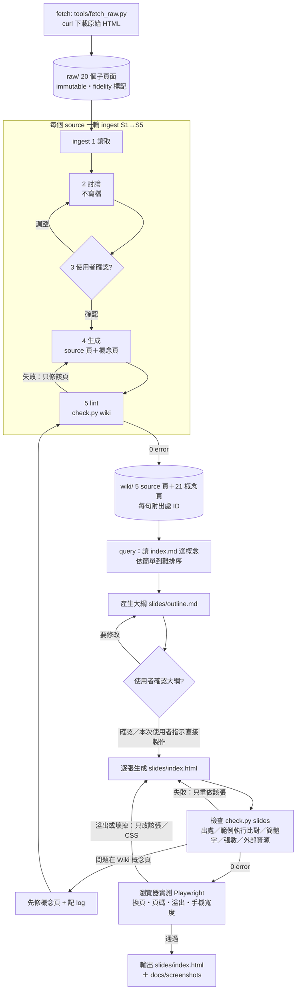

# Workflow 與 Graph 設計（作業步驟三、四）

## 1. 整體 graph

回圈共三種：(1) lint 失敗回「生成」只修該頁；(2) 投影片檢查失敗只重做該張；(3) 問題出在 Wiki 概念頁本身時，回到 Wiki 修概念頁、重跑 lint，再重做投影片。

## 2. 資訊怎麼流動：取得 → 整理 → 檢查 → 產生

1. **取得**：`tools/fetch_raw.py` 用 curl 下載 php.net 中文手冊 20 個子頁面的原始 HTML，擷取正文區塊、排除 User Contributed Notes，再用 pandoc 轉 Markdown 存進 `raw/`，每段標 `fidelity: verbatim`。不用 WebFetch，因為它會摘要、還會用模型自己的知識補內容，看起來像文件實際上沒有出處（CLAUDE.md §4）。章節目錄頁只用來確認子頁面網址。
2. **整理（ingest）**：一次一個 source；讀取 → 討論 → 確認 → 生成 → lint。Wiki 每一句知識都附 `[S2.4]` 這種出處 ID，ID 對應 raw 裡的子頁面，所以任何句子都能追回原文。
3. **檢查**：`tools/check.py` 把 CLAUDE.md 的規則寫成程式，而不是靠「看起來對」。
4. **產生簡報**：只查詢 Wiki（不用模型自己的知識）→ 大綱 → 每張一個重點一個短範例 → 每張頁尾標出處、`data-concepts` 標用到的概念頁，讓檢查器能機械式地從投影片追到概念頁再追到 raw。

## 3. 哪些步驟會重複、由哪條規則把關

| 重複的步驟 | 次數（本次實際） | 把關的檢查（tools/check.py） |
|---|---|---|
| 每個 source 一輪 ingest | S1、S2、S3、S4＋S5（共 4 次 ingest 紀錄，5 個 source） | `lint_wiki`：每句要有出處 ID、ID 要存在於 raw、出處要列在 frontmatter `sources`、summary 等級要標註、孤兒頁、`[[斷鏈]]`、`index.md` 完整 |
| 每次生成後的 lint | 5 次 ingest 後各一次＋最後整體 lint | 範例 `php -l` 與輸出比對（`check_example`）；版本號（`PHP 8.0.0` 這類）必須出現在所引用的 raw 原文 |
| 每張投影片的檢查回圈 | 16 張，檢查器跑了 3 次（2 次失敗、1 次通過） | `lint_slides`：張數 12–16、禁止 http 外部資源、內容頁要有 `data-concepts` 與頁尾出處、出處必須在概念頁 `sources` 裡、`pre.code` 實際執行並比對 `pre.output`、簡體字偵測（opencc，含程式碼註解） |
| 瀏覽器實測 | 3 輪（見反思） | 不在 check.py：用 Playwright 按 → 翻 16 頁，檢查頁碼、`scrollHeight > clientHeight`、橫向捲動、console 錯誤，桌機 1280×720 與手機 390×780 各一遍 |

為什麼這樣設計：
- **raw 不可變 ＋ 出處 ID**：知識的來源固定，任何一句話都能被機械式地追溯、反駁；修改 raw 會讓整條追溯鏈失效，所以要補內容只能新增並記 log。
- **只重做失敗的那一張**：其他已通過的投影片不動，避免「修一張壞兩張」的回歸，也讓 log 能精確記錄哪一張、什麼錯、怎麼修。
- **自動化檢查取代「看起來對」**：LLM 最危險的錯誤是「看起來很合理」，例如範例輸出是憑記憶寫的、版本號是猜的、示範輸出是舊版格式。讓程式去執行範例、比對輸出、核對版本號，才能抓到。
- **投影片的 HTML 慣例就是檢查介面**：`data-concepts`、`footer.src`、`pre.code`＋`pre.output` 讓檢查器不必理解內容就能驗證。

## 4. 本次數據

| 項目 | 數量 |
|---|---|
| raw 子頁面數 | 20（S1 4、S2 9、S3 4、S4 2、S5 1），20/20 verbatim |
| Wiki 頁數 | 5 個 source 頁＋21 個概念頁 |
| Wiki 內 PHP 範例（`php` 區塊） | 23 個（含 2 個非 `<?php` 的 HTML 片段，不執行） |
| 簡報投影片 | 16 張（內容頁 13、封面／學習目標／出處 3；含程式範例的 11 張，皆實際執行比對輸出） |
| Wiki lint 回圈失敗 | 見 log：S2 的 arrays 範例輸出缺 Deprecated 行 1 次；一次寫出「推論」句子由人工審查發現（非工具）；其餘 0 error |
| 簡報檢查回圈失敗 | 2 次：第 1 次 5 個 error（5 張）、第 2 次 1 個 error（1 張）、第 3 次 0 error。全部是簡體字偵測誤判，程式範例輸出第一次就全部一致 |
| 瀏覽器實測失敗 | 3 輪：第 1 輪 2 張溢出（9、13），第 2 輪 2 張（9、11），第 3 輪 0 張 |

## 5. 反思

**最常出錯的節點是「從來源取得／整理資料」，而不是投影片生成。** 依 log：
- 上一次執行（記錄在 CLAUDE.md §4）用 WebFetch 時，5 個章節首頁只有目錄，工具卻吐出像手冊的內容（其實是模型補的），所以 schema 加上可信度規則（只抓子頁面、標 fidelity、丟掉非頁面內容）。這次更進一步：fetch 節點改成 curl 下載原始 HTML（php.net 原本被網路政策擋住，另外建立只開放 www.php.net 的環境），從源頭保證逐字，而不是事後判斷工具輸出是不是摘要。這是把檢查往前移到最源頭。
- 原文本身也不全是官方內容：S2.8 裡夾了一段譯者註（「--haohappy 注」），在 ingest 時人工發現並排除。
- ingest S2 時，原文範例註解的輸出是舊版格式（`float(9.2233720368548E+18)`），實測 PHP 8.3.6 是 `float(9.223372036854776E+18)`；arrays 範例還多出一行原文沒有的 `Deprecated`。這些都是「範例執行比對」抓到的。所以該檢查不是等到簡報才做，而是**提前到每次 ingest 後的 Wiki lint**（`check_example`）；簡報檢查直接重用同一個函式。結果是簡報階段的範例輸出一次就全部通過，沒有因為範例錯而重做。
- 版本號檢查（`PHP 8.1.0` 必須出現在所引用的原文）同樣放在 Wiki lint，因為版本差異最容易被模型「推論」出來；truthy-falsy 一度寫了原文沒有的「即使元素是 0」，是人工審查才發現，之後改以原文有的例子取代。

**簡報階段實際遇到的錯**（誠實記錄）：
1. 簡體字檢查第 1 次失敗 5 張：opencc `s2t` 把正體字「吃」「只」「才」誤判為簡體（它們在 s2t 轉換表中有異體對應，例如「吃掉」→「喫掉」）。我當下判斷這是檢查器的誤判；我嘗試把設定改成 `s2tw`（實測 `s2tw` 不會誤判這三個字），但這個修改工具檔的動作被權限系統擋下，所以**沒有改 check.py**，改為把投影片的措辭換掉（「吃掉換行」→「換行不會輸出」、「只影響」→「僅影響」、「才是」→「是／就變成」）。第 2 次還剩 1 張（小測驗，「才是字串連接」）同樣原因，修後通過。這件事留下一個待辦：check.py 的 `s2t` 應改用 `s2tw`，這是讓人決定要不要改檢查器。
2. 瀏覽器實測抓到檢查器看不到的問題：桌機 1280×720 下，陣列與常數兩頁程式碼太長而溢出，頁尾出處與輸出區重疊；修正方式是把頁尾從絕對定位改成 flex 流程中的底部元素、縮短範例（不改內容）、略縮小程式碼字級；第 2 輪還剩陣列、變數兩頁，再縮字級後通過。手機寬度（390×780）因為改成單欄可捲動，一直沒有問題。

3. 主代理審查子代理成果時（本次簡報由 Sonnet 子代理產生）又抓到兩個問題：
   - slide 4 的因果寫錯：說「標籤外內容原樣輸出，所以 Some text 和 No newline 黏在一起」，真正原因是 `?>` 後緊接的換行不會輸出。出處 ID、範例輸出都正確，所以 check.py 全部通過，只有人讀才抓得到。
   - 修正時用了「吃掉」，又踩到同一個「吃」→「喫」誤判。檢查器的缺陷不修，就會一再造成重工。
4. log 的時間戳記是 LLM「估」的：原本寫到 19:10，但當時系統時間才 18:05。這和範例輸出憑記憶寫、版本號用猜的是同一類錯誤，已依檔案修改時間校正。之後時間戳記應該由指令（`date`）產生，不能手寫。

**這次對 workflow／graph 的修改與原因：**
- fetch 節點：WebFetch → curl 抓原始 HTML（避免摘要與補內容）。
- 範例執行比對與版本號檢查：從「簡報檢查」提前到「每次 ingest 後的 Wiki lint」，讓錯誤在離 raw 最近的地方被抓到，而不是帶進簡報才發現。
- 新增「問題在 Wiki 概念頁 → 回修概念頁並重跑 lint」的回圈（graph 中的 FIX 節點），避免在投影片裡硬繞過 Wiki 的錯。
- 瀏覽器實測成為正式節點，而且失敗時可回到「生成」：因為溢出這類視覺問題，check.py 完全看不到。
- 使用者指示「不用討論，直接製作」，因此 ingest 的「討論／確認」與大綱的「確認」在本次都被跳過，但 graph 仍保留這兩個節點，並在 log 記錄「本次跳過」的決定，以保持流程可追溯。

**如果再做一次**：
- 檢查器在 S1 做過負向測試（故意寫錯輸出、拿掉出處，兩個都抓到），但沒有做「不該報錯的情況」測試（正體字），所以 `s2t` 誤判一直到簡報階段才出現。檢查器要同時測「該抓的抓得到」和「不該抓的不會誤報」。
- 溢出檢查應該寫進自動化腳本（這次是用 Playwright 臨時寫的）。
- 語意正確性（因果、推論）目前只能靠人工審查。所以 graph 在「檢查」之後保留人工逐張審查，而且審查者最好不是生成者：這次就是主代理審查子代理時抓到的。
